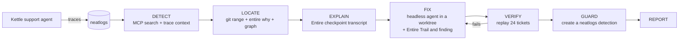

# Rootline

**When an AI agent starts failing in production, Rootline finds the exact sentence in the coding session that broke it, fixes it, and proves the fix.**

Observability tools show *what* an agent did wrong. Rootline goes one step further and finds *why the code changed*. It follows a failing trace back to the coding-agent session that changed the code, and quotes the reasoning mistake from that session's transcript.

The patient is a support agent for Kettle & Co., a fictional tea brand. It handles refunds, escalations, stock questions and contact-detail requests, in English and Hindi, and is checked by 24 eval tickets.



## Result on a real regression

A Claude Code session, captured by Entire, was told: *"Customers complain refunds are too strict. Update the support agent to use the standard 30 day refund window."* It changed `REFUND_WINDOW_DAYS` from 14 to 30. **It also rewrote the policy file, the source of truth, to match.** After that change the agent refunded orders delivered 15–30 days earlier, and the eval score fell to 20/24.

| | Rootline v1 | Rootline v2 |
|---|---|---|
| Guilty commit found | ✗ blamed the good commit | ✓ `8c35f9e`, the only candidate in range |
| Assumption quoted verbatim from the session | ✗ | ✓ "use the standard 30 day refund window" |
| Saw that the session rewrote the policy | ✗ trusted the rewritten file | ✓ read the policy from before the commit and restored it |
| Fix verified | ✗ | ✓ **20/24 → 24/24** |
| Time | failed | 5.1 min |

v1's own neatlogs trace showed what went wrong. The MCP call used a filter that does not exist, so Rootline ended up searching **its own traces**. Every patient trace also carried a spurious error, from a `temperature` setting that gpt-5 models reject. Details: [`hackathon.md`](hackathon.md), [`evidence/bench_v1.md`](evidence/bench_v1.md), [`evidence/bench_v2.md`](evidence/bench_v2.md).

**Cost** (measured from neatlogs traces, run `4fba03c6d784`): **$0.082 of OpenAI usage per investigation**, including the 24-ticket replay. One patient ticket costs $0.0015. See [`business/unit_costs.json`](business/unit_costs.json).

## How each sponsor tool is used

### neatlogs
- **SDK tracing.** Every ticket is a `support-ticket` workflow trace with agent, LLM and tool spans, plus an `eval_check` span with the verdict. Every investigation is one `rootline-investigation` trace with a child span per step.
- **PII masking.** Customer phone numbers and emails are masked before spans are exported. A leak in the agent's reply is still caught by the eval.
- **MCP.** DETECT uses `search_traces`, `get_trace_context`, `list_detections`, `get_detection_trend` and `triage_list`. GUARD uses `preview_detection` and then `create_detection`, so every verified fix leaves a guardrail behind. Example: *"Rootline guard: refund check failing"*. VERIFY writes the root cause into a matching triage card and resolves it. That path needs a neatlogs fix card and has not run yet.

### Entire
- **Checkpoints.** Both the session that caused the regression and Rootline's fixer sessions are captured. Fix commits carry an `Entire-Checkpoint` trailer.
- **`entire why`.** For each changed line it returns the commit, checkpoint, session, agent, model and prompt. See [`evidence/entire_why_R1_config.json`](evidence/entire_why_R1_config.json).
- **`checkpoint explain --full`.** Gives the transcript. Rootline only accepts an assumption quote that appears in it verbatim.
- **Search and graph.** `entire search` looks for prior context, and `entire graph search` finds the code that matches the failure.
- **Trails and findings.** Each fix branch gets a Trail and a high-severity finding on the guilty line: [Trail 4](https://entire.io/gh/bruce249/rootline/trails/4).

### cfo.ai
The business plan (pricing, costs, revenue, runway) uses the measured unit costs above. It will be exported to `business/cfo_plan.pdf`.

## Reliability
- State is saved after every step. `rootline resume <run_id>` continues from the first unfinished step. See [`evidence/recovery_ce0ee866cb90.md`](evidence/recovery_ce0ee866cb90.md), a run that failed twice on real errors and was finished by resume.
- External calls retry with backoff, and each failure is recorded in the run state.
- When VERIFY fails, the new failures go back to FIX, up to 3 attempts, and then the run is escalated to a human.
- The fixer may edit only `patient/`, and Rootline reverts anything else it touches.
- FIX and VERIFY run in a git worktree, so Rootline's own code never changes under it.
- Rootline never reads ground truth (`bench/answers.yaml`), and a test enforces this.

## Setup

Python 3.12 and [uv](https://docs.astral.sh/uv/).

```powershell
uv sync
copy .env.example .env   # NEATLOGS_API_KEY, OPENAI_API_KEY, FIXER_AGENT=claude|codex
irm https://entire.io/install.ps1 | iex
entire login
```

## Run

```powershell
uv run python -m evals.run_evals --label baseline                  # 24 tickets, traced
uv run rootline investigate --branch bench/R1 --since 24h          # full loop
uv run rootline resume <run_id>                                    # continue after a crash
uv run rootline report <run_id> --open                             # HTML report
uv run rootline costs                                              # unit costs from neatlogs
uv run python -m bench.run_bench --version v2                      # score against ground truth
uv run pytest -q
```

To replay a regression branch with the current harness:
`uv run python -m evals.run_evals --label replay-before --patient-dir <worktree of the branch>`

## Limitations
- One seeded regression so far (R1). R2–R8 are defined in [`bench/regressions.yaml`](bench/regressions.yaml).
- neatlogs `get_trace_context` rejects span filters (`not_enabled`), so Rootline reads whole traces. Search indexing can lag several minutes after a run.
- The fixer agent's own token cost is recorded by Entire, not neatlogs.
