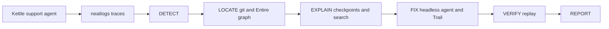

# Rootline

When an AI support agent starts failing in production, Rootline finds the reasoning mistake in the coding session that caused it, fixes it, and proves the fix.

The patient is a small support agent for Kettle & Co., a fictional tea brand. It is traced in neatlogs. Rootline reads those traces, locates the bad commit, reads the Entire checkpoint of the coding session, applies a fix, and replays the tickets.



## Setup

Python 3.12 and [uv](https://docs.astral.sh/uv/).

```powershell
uv sync
copy .env.example .env
```

Fill `.env` with `NEATLOGS_API_KEY` and `OPENAI_API_KEY`. Patient model is `gpt-5-mini`. Investigator model is `gpt-5`.

Install Entire, then log in with GitHub:

```powershell
irm https://entire.io/install.ps1 | iex
entire login
```

Install the Entire GitHub App on the repo, then turn on Runners, Auto build on push, and Trails.

## Run

```powershell
uv run python -m evals.run_evals --label baseline
uv run rootline investigate --branch <failing-branch>
uv run rootline resume <run_id>
uv run rootline report <run_id> --open
```

Baseline numbers below are filled only after a real run. None have been recorded yet.

## What is still human-operated

- Public GitHub repository and push
- Entire login and repo settings
- neatlogs detections in the dashboard
- cfo.ai plan, after cancelling the paid trial immediately
- One EC2 `t3.small` in `us-east-1` inside `Hackathon_VPC`, later, for watch mode
